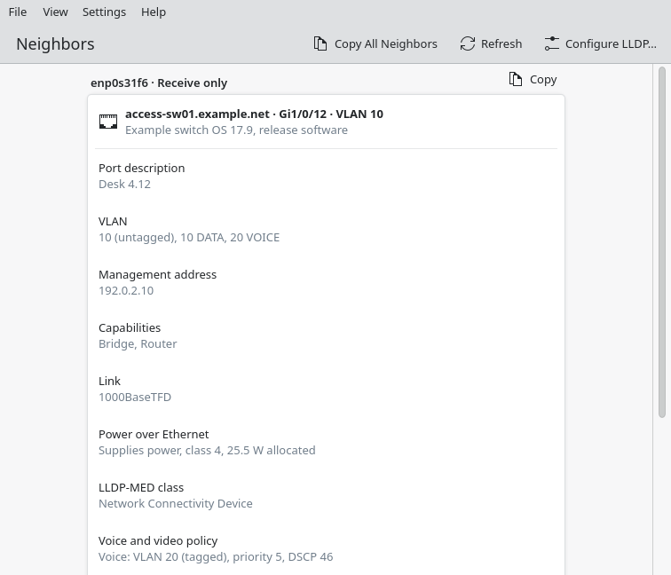
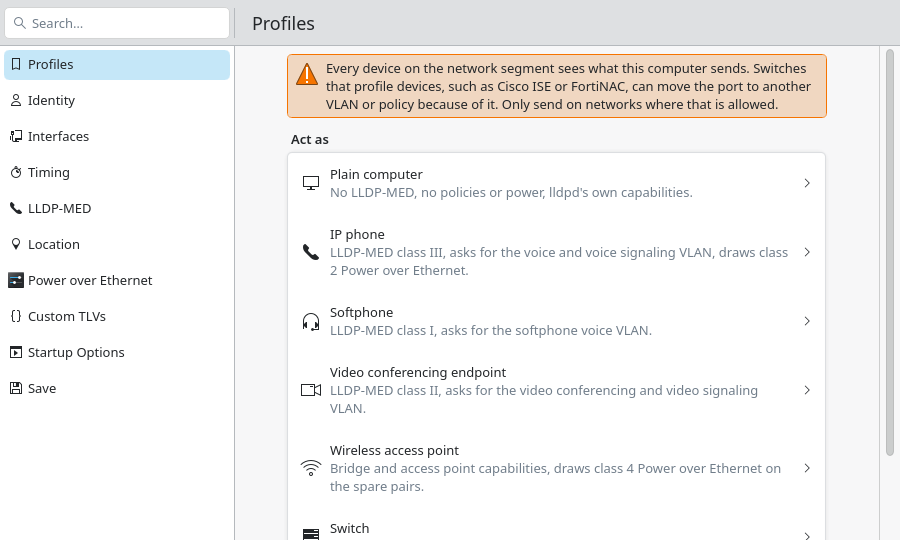

# plasma-lldp-workbench

A KDE Plasma app that shows which switch, port and VLAN this computer is connected to, using
LLDP (IEEE 802.1AB) and LLDP-MED, and that controls everything this computer sends over LLDP.

> [!WARNING]
> **This software is fully vibe coded and experimental. Use it at your own risk.**
> It was written with an AI coding assistant. It changes the configuration of lldpd, can
> restart lldpd and can make this computer present itself to the network as another kind of
> device. Read what a change does before you apply it.

> [!IMPORTANT]
> **Only use this tool to assess your own internal network.** Using it on external networks,
> or on any network you do not own, requires the explicit permission of the network's owner.



## What it can be used for

- **Finding the switch port**: the switch name, port, port description, untagged and tagged
  VLANs, management address, link speed and Power over Ethernet, per interface.
- **Testing switch security**: switches and network access control (NAC) systems often decide
  on VLANs and policies from what a device announces over LLDP and LLDP-MED. This app can make
  the computer announce itself as an IP phone, a softphone, a video conferencing endpoint, a
  wireless access point or a switch, ask for a voice VLAN, and claim Power over Ethernet. That
  shows whether a port hands out a voice VLAN or another policy to anything that claims to be
  a phone, which is worth knowing when you harden your own network. Only do this on networks
  you own or are allowed to test.

## Features

- Neighbors per interface, updated live, with a tray icon whose tooltip shows
  "switch · port · VLAN" and a notification when the switch or port changes.
- Copy as text, per interface or all at once, for a ticket or a chat.
- A menu bar with configurable keyboard shortcuts, a command bar (Ctrl+Alt+I) and an About
  page.
- A settings window covering every runtime setting of lldpd:
  - **Profiles**: plain computer, IP phone, softphone, video conferencing endpoint, wireless
    access point, switch. A profile only fills in values; you check them and press Apply.
  - **Identity**: system name, description, chassis ID, platform, capabilities, management
    addresses.
  - **Interfaces**: which interfaces lldpd uses, send/receive per interface, port ID and
    description, sending LLDP tagged in a VLAN, VLANs to advertise.
  - **Timing**: interval, hold multiplier, fast start, destination address, neighbor limit.
  - **LLDP-MED**: device class, inventory, voice and video network policies.
  - **Location**: coordinates, civic address, emergency location number (ELIN).
  - **Power over Ethernet**: LLDP-MED and 802.3 power, as a powered device or as power
    sourcing equipment.
  - **Custom TLVs**: your own organizationally specific TLVs.
  - **Startup options**: LLDP-MED class, no inventory, hide the kernel version, receive only.
  - **Save**: write the applied settings to `/etc/lldpd.d/plasma-lldp-workbench.conf`.



Changes wait until you press **Apply**; the bar at the bottom of every settings page shows the
exact `lldpcli` commands first.

## How it works

The app does not send or receive anything itself: [lldpd](https://lldpd.github.io/) does.
The app reads lldpd over its control socket and changes it with `lldpcli`, the same commands
the Save page writes.

Some things only change when lldpd starts or restarts: the LLDP-MED device class and the other
startup options, and removing an LLDP-MED policy, location or power setting, a fixed port ID or
the VLAN for sending (lldpcli has no command to take those back). For those the app uses a
small helper that runs as root through polkit and asks for your password. It saves the settings
you applied first, because a restart loses runtime settings, then writes lldpd's startup
options (a systemd drop-in in `/etc/systemd/system/lldpd.service.d/` or `LLDPD_OPTS` in
`/etc/conf.d/lldpd` on OpenRC) and restarts lldpd.

## LLDP versions

LLDP has one frame format. The 2005 and 2009 editions of IEEE 802.1AB (the 2009 edition is often
called LLDPv2) differ in agent types: 2009 added the nearest non-TPMR bridge and nearest
customer bridge destination addresses next to the nearest bridge one. lldpd speaks both
editions; the Destination setting on the Timing page picks the address.

## Limits

- lldpd only allows capabilities the computer really has, so "telephone" cannot be claimed.
  Switches recognise phones through LLDP-MED anyway.
- lldpd 1.0.18 (Debian 13, Fedora 45) does not have the "VLANs to advertise" and "port
  description source" settings and cannot interrupt a live watch; the app hides those settings
  there and refreshes every five seconds instead of live.
- CDP, EDP and FDP are not covered.

## Installing

Packages for Debian 13, Fedora 45 and Arch Linux are attached to each
[release](https://github.com/nvaert1986/plasma-lldp-workbench/releases), with a
`SHA256SUMS` file:

```
apt install ./plasma-lldp-workbench_0.1.0-1_amd64.deb
dnf install ./plasma-lldp-workbench-0.1.0-1.fc45.x86_64.rpm
pacman -U plasma-lldp-workbench-0.1.0-1-x86_64.pkg.tar.zst
```

Run these as root.

## Setting up lldpd

1. Start lldpd: `systemctl enable --now lldpd` (systemd) or
   `rc-update add lldpd default && rc-service lldpd start` (OpenRC).
2. Add your user to the group that owns lldpd's control socket (`lldpd` on Gentoo, Arch and
   Fedora, `_lldpd` on Debian), then log out and back in: `gpasswd -a <user> lldpd`.
3. lldpd sends LLDP by default. To only listen, set the interfaces to "Receive only" in the
   app, or put `configure lldp status rx-only` in `/etc/lldpd.conf`.

## Building

Needs KDE Frameworks 6.13 or newer, Qt 6.8 or newer, Kirigami Addons 1.4 or newer and lldpd 1.0
or newer with its client library (`lldpctl`).

```
cmake -B build -G Ninja -DCMAKE_BUILD_TYPE=Release -DCMAKE_INSTALL_PREFIX=/usr
ninja -C build
ctest --test-dir build
cmake --install build
```

The root helper only works when installed under `/usr`, where D-Bus and polkit look for it.

## Command line

- `--hidden`: start in the tray, as the autostart entry does
- `--demo`: show invented neighbors instead of asking lldpd

## Tested

| Distribution | Built | Installed | Started |
|---|---|---|---|
| Gentoo (KF 6.31, Qt 6.10, lldpd 1.0.22) | yes | from the build tree | yes, on a real network |
| Debian 13 (KF 6.13, Qt 6.8, lldpd 1.0.18) | in podman | in podman | headless in podman |
| Fedora 45 (KF 6.31, lldpd 1.0.18) | in podman | in podman | headless in podman |
| Arch Linux (KF 6.31, lldpd 1.0.23) | in podman | in podman | headless in podman |

"In podman" means the package was built, installed into a fresh container of that distribution,
started headless with the settings window open, and removed again. The tray icon and
notifications have only been used on Gentoo; the root helper (Save Permanently, startup options)
has not been tested on a real system yet.

## Licence

GPL-3.0-or-later
